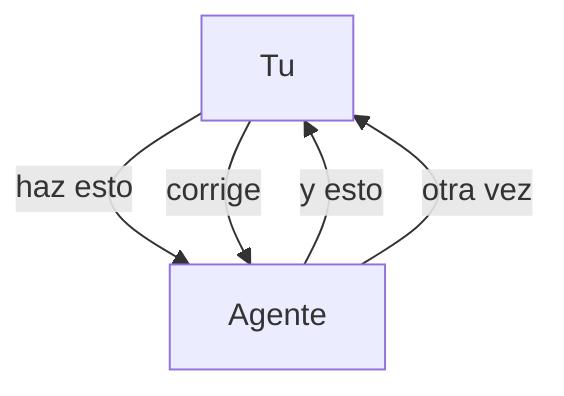
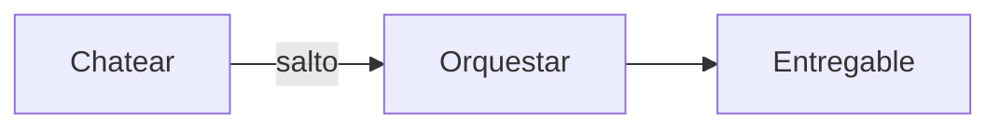
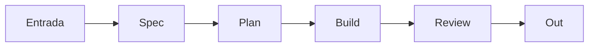
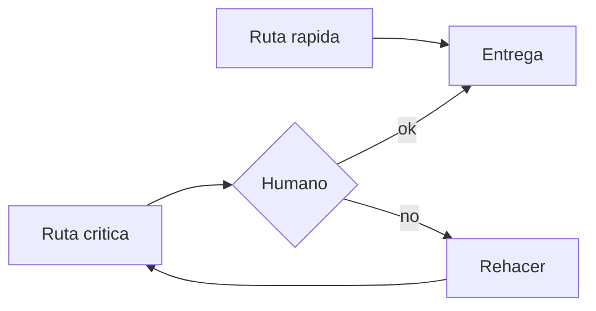

# Software Factory

Idea visual del modelo. No es el metodo completo.

**Dejar de chatear → empezar a orquestar.**

---

## 1. El problema

Hoy el humano esta en medio del chat. Sin salida.

---

## 2. El salto

Mismo tipo de agente. Otro sistema.

---

## 3. La fabrica

La peticion entra. El entregable sale.

---

## 4. Piezas

| Pieza | Que hace |
| --- | --- |
| Contexto | memoria del proyecto |
| Roles | cada agente un oficio |
| Gates | humano donde importa |
| Rastro | todo auditable |

---

## 5. Gates

