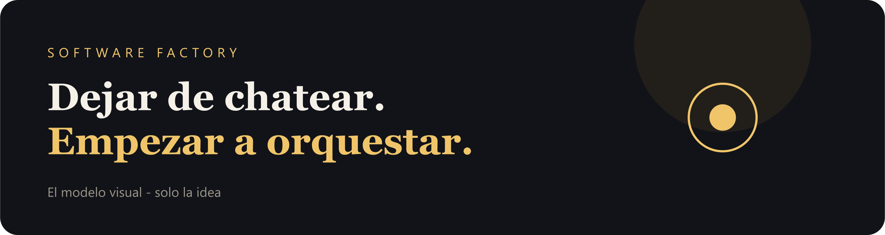
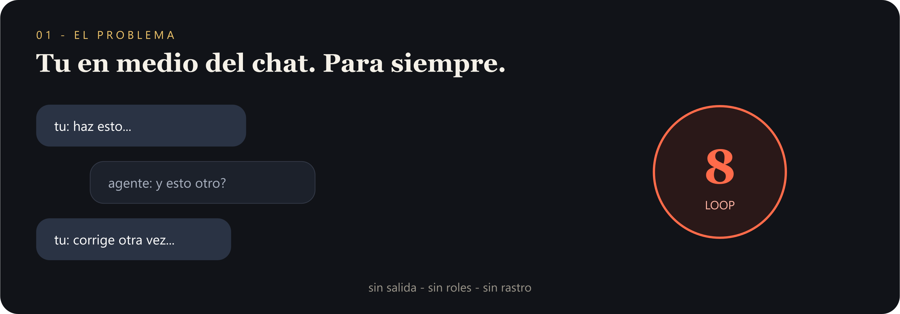
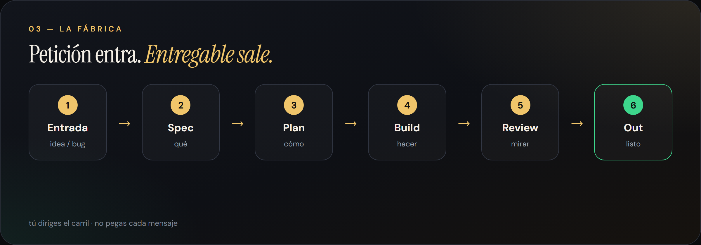
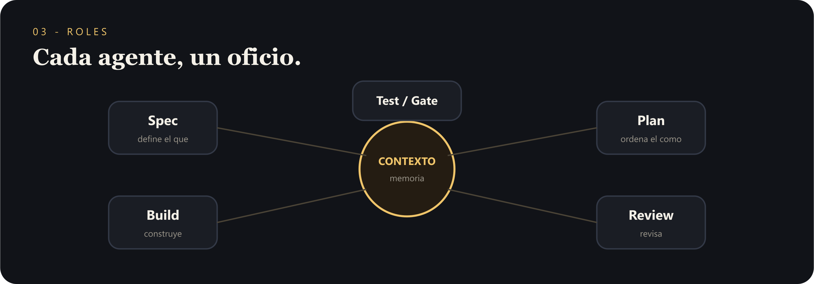

# Software Factory

**[Abrir la idea animada →](https://sergioivorra.github.io/Manual-Software-Factory-ES/)**

Página visual con **GSAP** (scroll, pipeline, tracers) + **Mermaid** (gates).  
No es el método completo. Solo el modelo.

---

---

**Idea:** dejar de chatear → orquestar.
