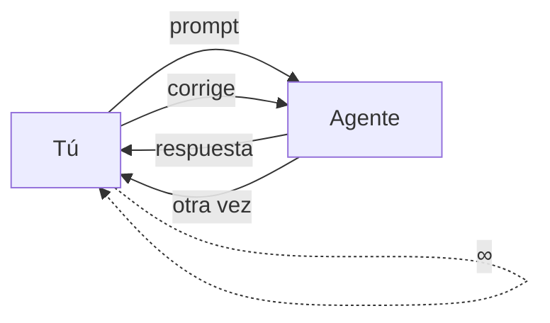
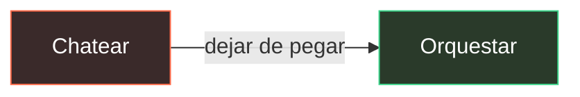
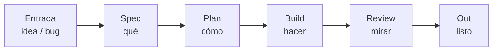
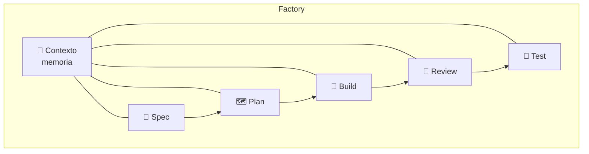
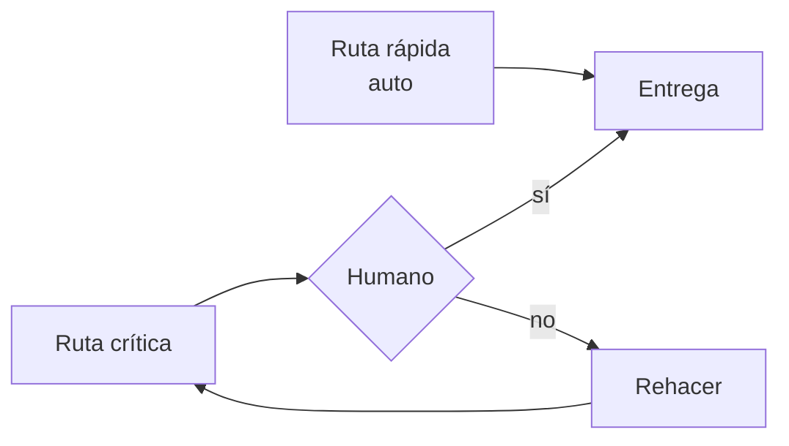

# Software Factory — la idea

> No es un chat mejor. Es una **fábrica**.

**[▶ Abrir la versión animada](https://sergioivorra.github.io/Manual-Software-Factory-ES/)**

---

## 1. El problema (tú en medio)



---

## 2. El salto



---

## 3. La fábrica (pipeline)



---

## 4. Roles (cada uno un oficio)



---

## 5. Gates (humano solo donde importa)



---

## 6. En una frase

```text
chat ∞  →  spec → plan → build → review → out
         (tú diriges, no pegas)
```

Poco texto. Solo el modelo.  
La animación está en la [página](https://sergioivorra.github.io/Manual-Software-Factory-ES/).
