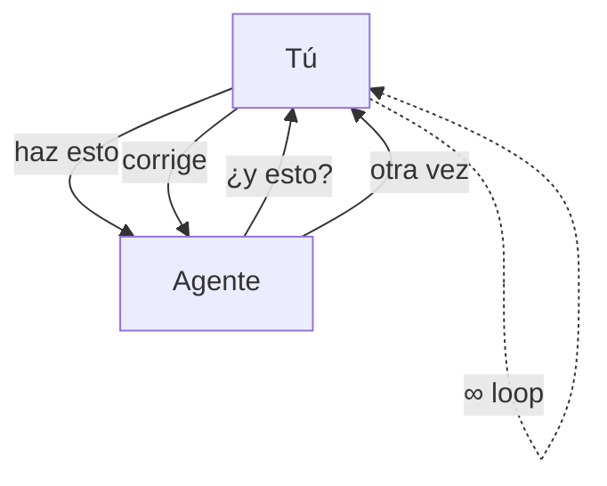
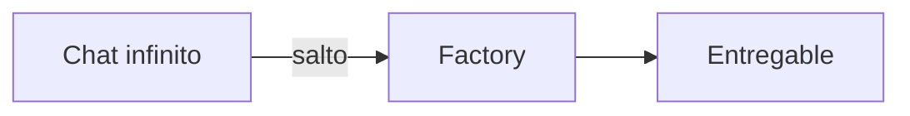
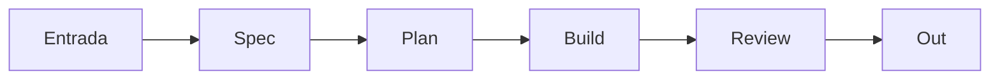

---

## 01 — El problema

---

## 02 — El salto

---

## 03 — La fábrica

---

## 04 — Piezas

| Pieza | Qué hace |
| --- | --- |
| **Contexto** | memoria del proyecto |
| **Roles** | cada agente un oficio |
| **Gates** | humano solo donde importa |
| **Rastro** | todo auditable |

---

## 05 — Gates

---

**Idea:** dejar de chatear → orquestar.

Hecho con cosas que ya existen:
[capsule-render](https://github.com/kyechan99/capsule-render) ·
[readme-typing-svg](https://github.com/DenverCoder1/readme-typing-svg) ·
[shields.io](https://shields.io) ·
[badges.ws](https://badges.ws) ·
[Mermaid](https://mermaid.js.org) (nativo en GitHub)

