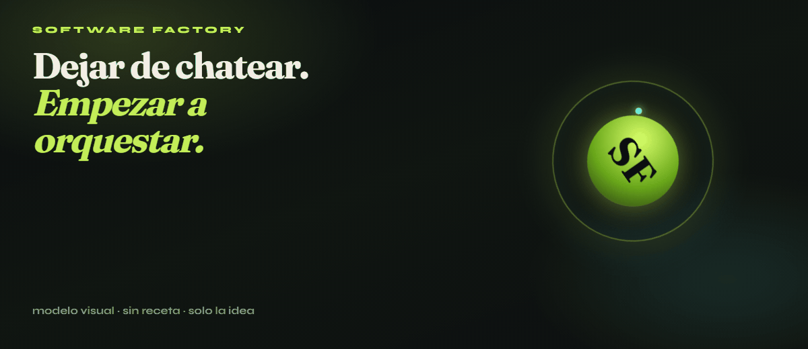
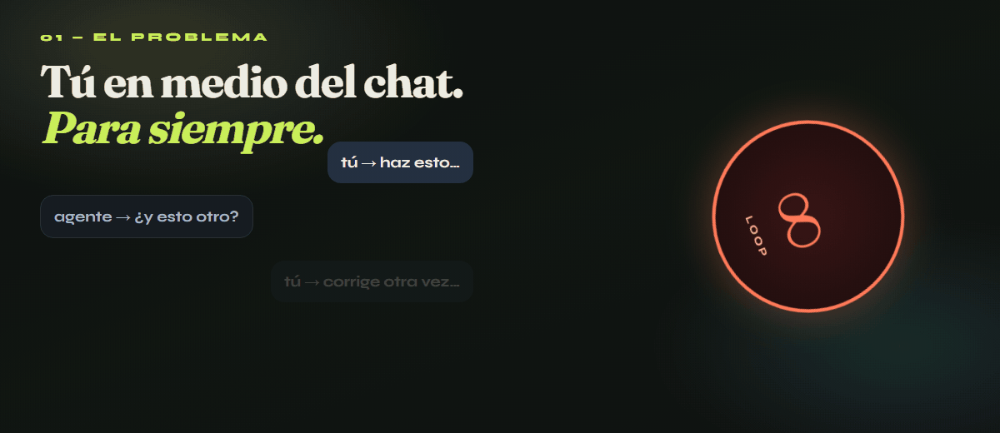
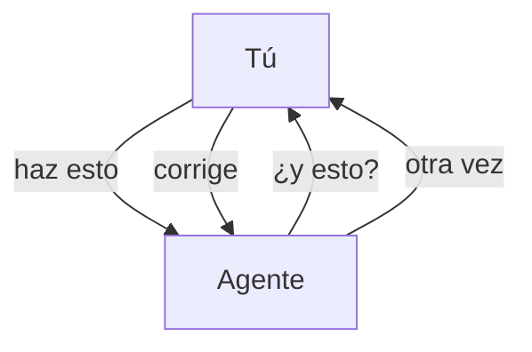
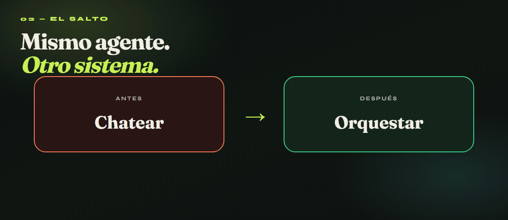
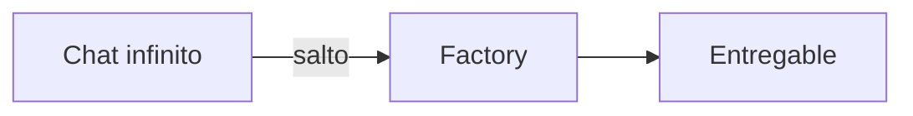
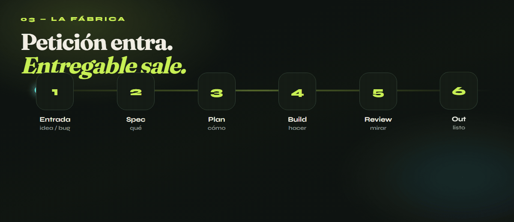
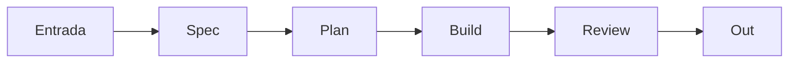

---

## 01 — El problema

---

## 02 — El salto

---

## 03 — La fábrica

---

## 04 — Gates

---

**Idea:** dejar de chatear → orquestar.

Animaciones hechas con [GSAP](https://gsap.com) + [Playwright](https://playwright.dev) + [ffmpeg](https://ffmpeg.org) → GIFs que sí se mueven en GitHub.

