# Software Factory

Idea visual del modelo. No es el metodo completo.

## [▶ Ver la explicacion (video)](https://sergioivorra.github.io/Manual-Software-Factory-ES/ver.html)

**[Abrir reproductor](https://sergioivorra.github.io/Manual-Software-Factory-ES/ver.html)** ·
**[Descargar MP4](./assets/software-factory-explicacion.mp4)**

**Dejar de chatear → empezar a orquestar.**

---

## Esquema 01 — El problema: tu en medio

Hoy programas con IA como si fuera un chat: un solo agente y tu en el centro. Pedir, revisar, corregir, otra vez. No hay salida del loop.

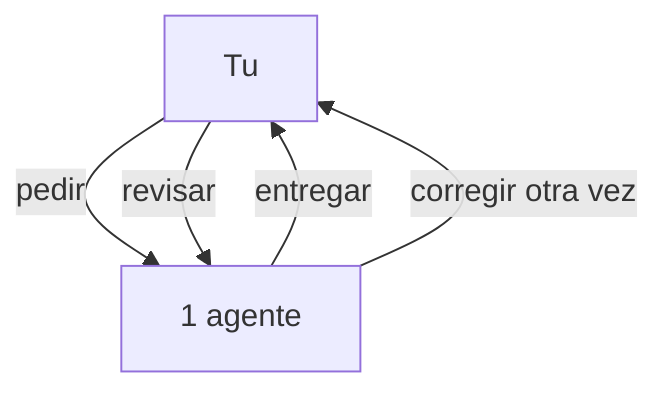

---

## Esquema 02 — Como se siente ese chat

No falla la IA: falla el modelo. Cada mensaje te obliga a volver a meter contexto, criterio y decision.

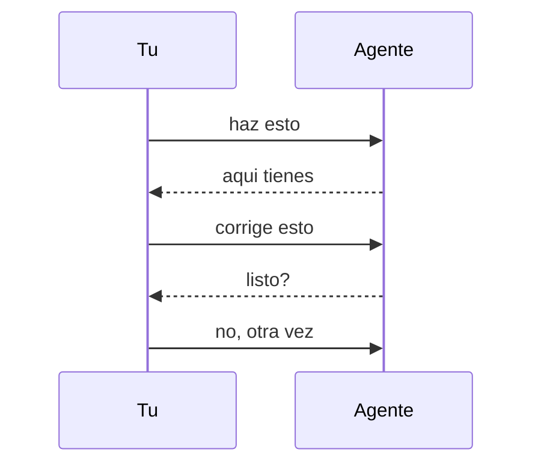

---

## Esquema 03 — El salto de modelo

El salto no es "un agente mejor". Es dejar de chatear y pasar a orquestar: peticion entra, entregable sale.

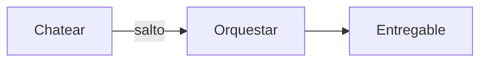

---

## Esquema 04 — Hoy vs Software Factory

Misma materia prima (agentes). Distinto sistema: tu dejas de ser el pegamento y pasas a dirigir.

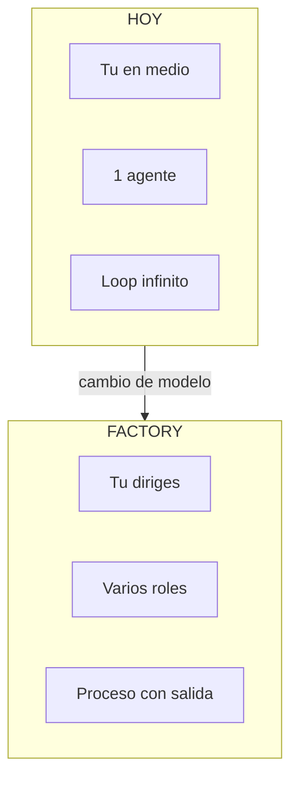

---

## Esquema 05 — Que es una Software Factory

No va de usar mas herramientas de IA. Va de un proceso con roles: spec, plan, build, review, entrega.

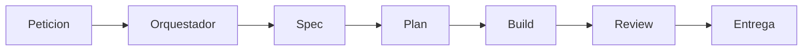

---

## Esquema 06 — El flujo tiene estados

Una factory no improvisa en el chat: avanza por estados. Si review falla, vuelve a build. Si pasa, entrega.

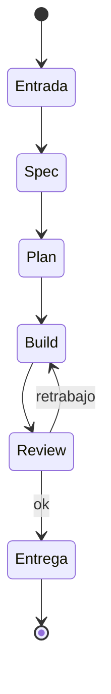

---

## Esquema 07 — Las 4 piezas

Sin estas piezas sigues en modo chat, aunque tengas 10 agentes.

- **Contexto:** memoria del proyecto (no reexplicar cada vez)
- **Roles:** cada agente un oficio
- **Gates:** humano solo donde importa
- **Rastro:** todo auditable

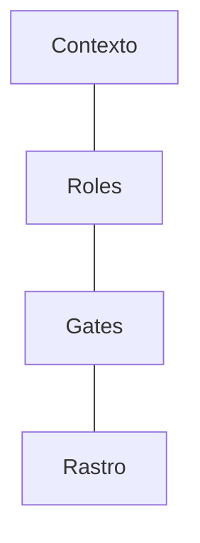

---

## Esquema 08 — Roles especializados

De la peticion al pull request: un agente especifica, otro planifica, otros implementan en paralelo, luego review.

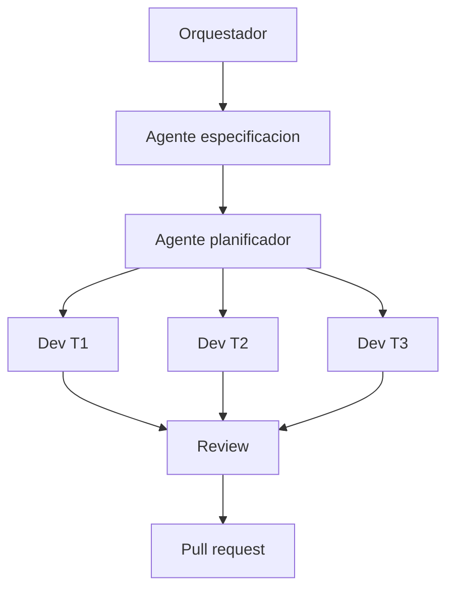

---

## Esquema 09 — Como habla el sistema

Tu no pegas con cada agente. Hablas con el orquestador. El reparte trabajo y te devuelve un entregable.

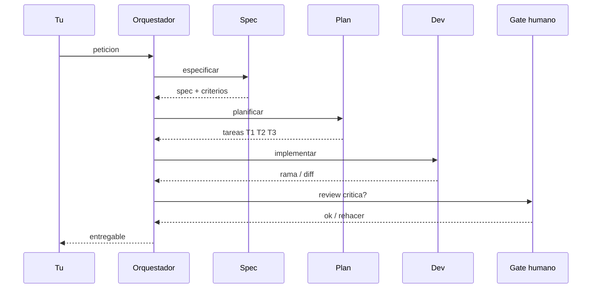

---

## Esquema 10 — Camino completo a PR

El objetivo no es "una respuesta bonita". Es una salida ingenieril: spec → plan → codigo → tests → review → PR.

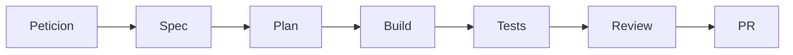

---

## Esquema 11 — Que produce cada fase

Spec define el que. Plan parte el trabajo. Build ejecuta en ramas aisladas con checks. Asi no se mezcla todo en un solo hilo de chat.

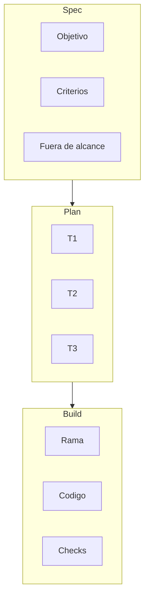

---

## Esquema 12 — Gates: donde entra el humano

No revisas todo. Ruta rapida si el riesgo es bajo. Ruta critica si el impacto es alto: ahi el humano decide.

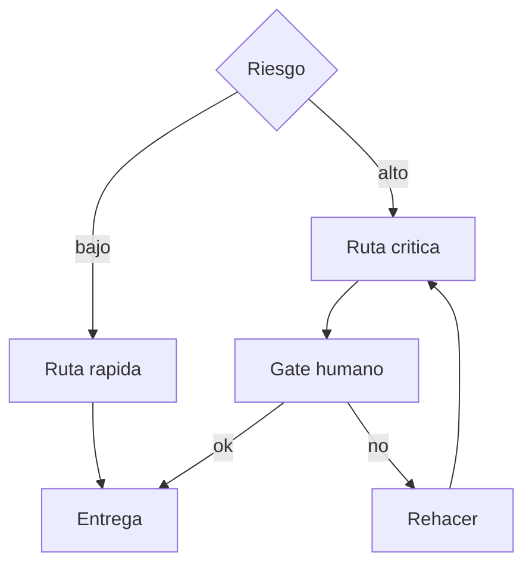

---

## Esquema 13 — Vista completa del modelo

Tu diriges. El orquestador coordina. El contexto sostiene. Los roles producen. El gate protege. El rastro queda.

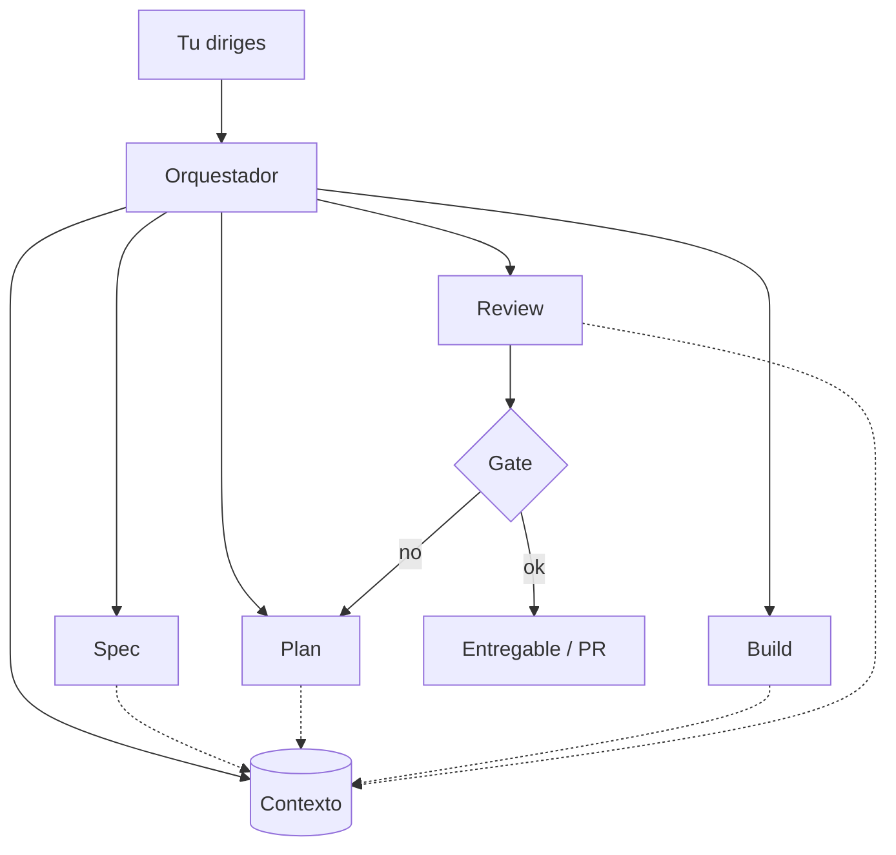

---

**Cierre:** programar con IA... o dirigir equipos de agentes?
