# Software Factory

Idea visual del modelo. No es el metodo completo.

## [▶ Ver la explicacion (video)](https://sergioivorra.github.io/Manual-Software-Factory-ES/ver.html)

**[Abrir reproductor](https://sergioivorra.github.io/Manual-Software-Factory-ES/ver.html)** ·
**[Descargar MP4](./assets/software-factory-explicacion.mp4)**

**Dejar de chatear → empezar a orquestar.**

---

## Esquema 01 — Loop actual

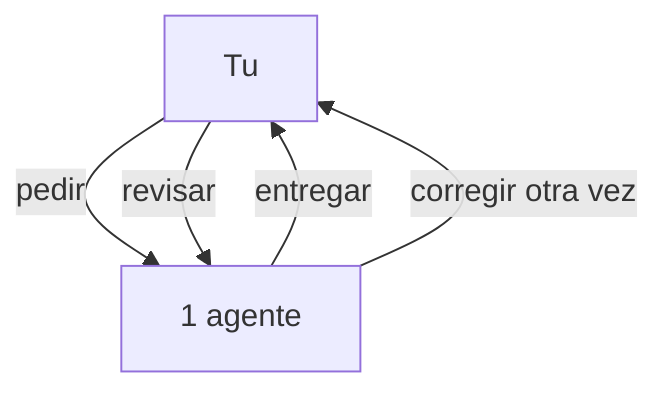

## Esquema 02 — Secuencia del chat

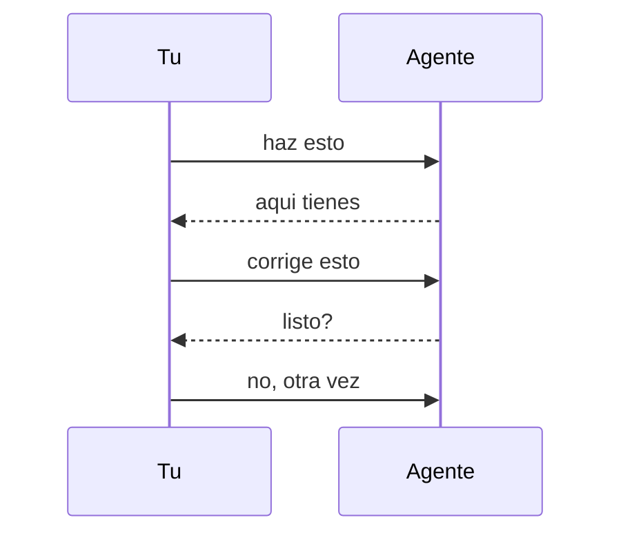

## Esquema 03 — El salto

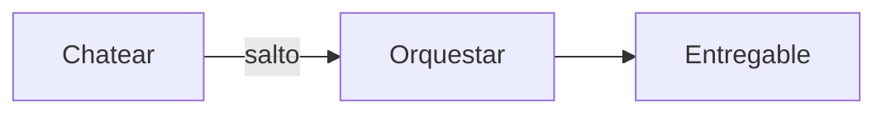

## Esquema 04 — Hoy vs Factory

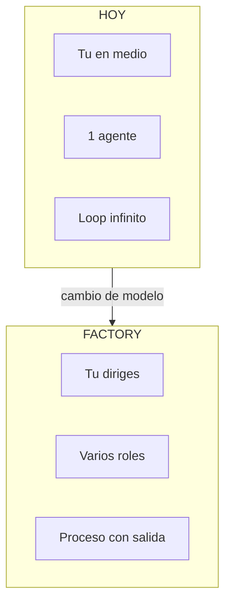

## Esquema 05 — Pipeline

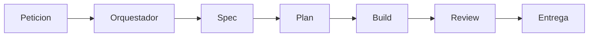

## Esquema 06 — Estados del flujo

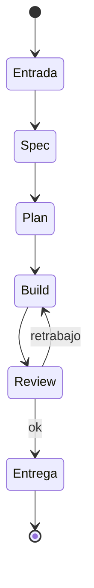

## Esquema 07 — Piezas del sistema

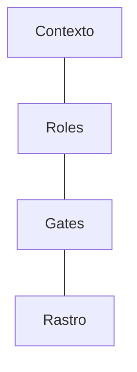

## Esquema 08 — Orquestador y agentes

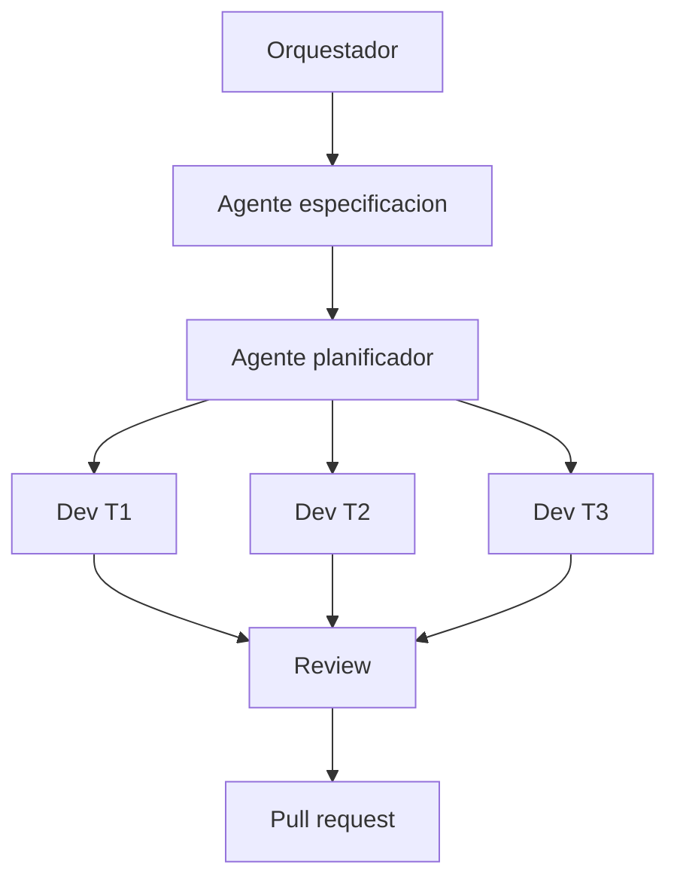

## Esquema 09 — Secuencia Factory

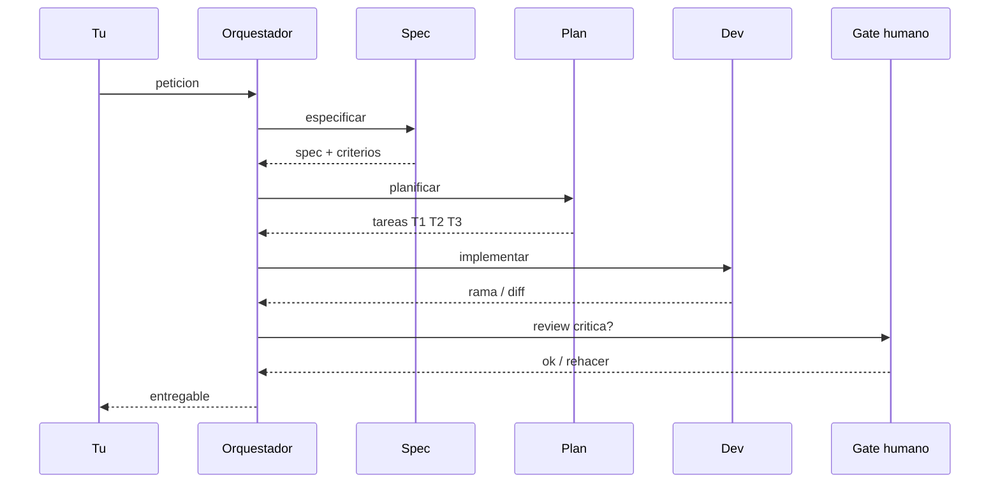

## Esquema 10 — De peticion a PR

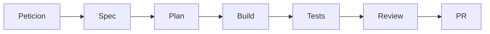

## Esquema 11 — Spec / Plan / Build

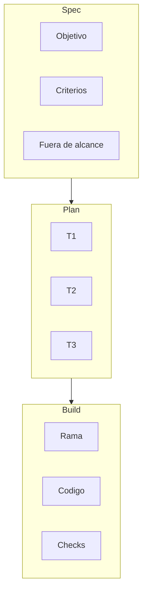

## Esquema 12 — Gates

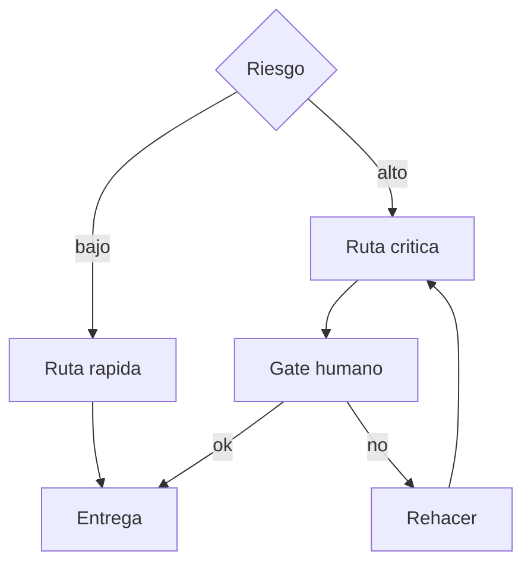

## Esquema 13 — Vista completa

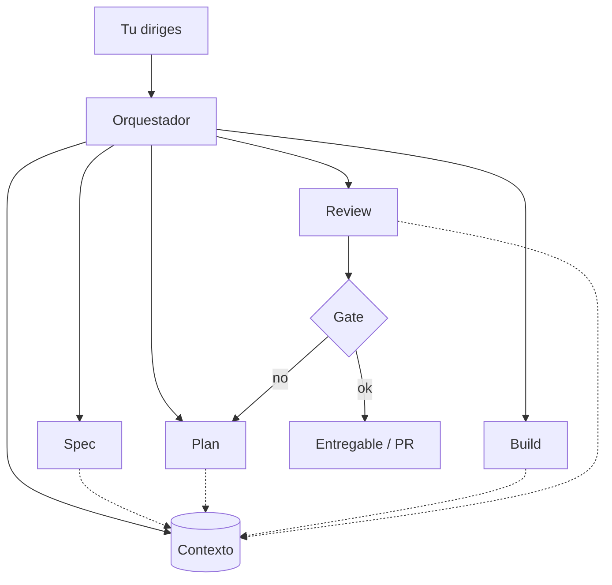

---

**Pregunta:** programar con IA... o dirigir equipos de agentes?
