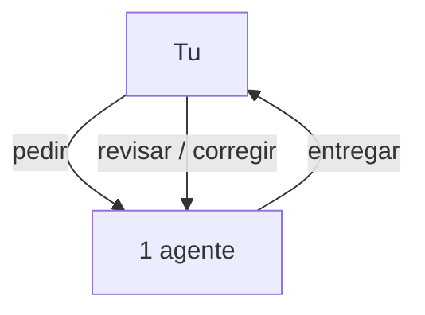
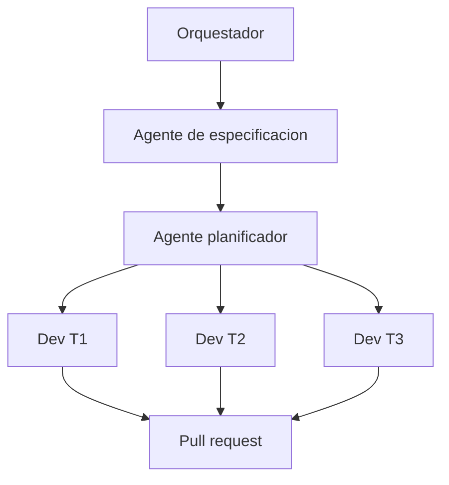
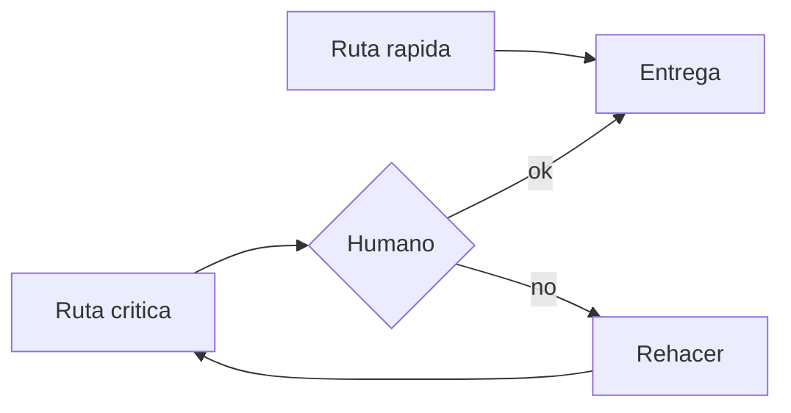

# Software Factory

> GitHub no deja reproducir MP4 dentro del README. El video se ve aqui:

## [▶ Ver la explicacion (video)](https://sergioivorra.github.io/Manual-Software-Factory-ES/ver.html)

**[Abrir reproductor](https://sergioivorra.github.io/Manual-Software-Factory-ES/ver.html)** ·
**[Descargar MP4](./assets/software-factory-explicacion.mp4)**

Idea visual del modelo. No es el metodo completo.

---

## Resumen (mismo hilo que el video)

### 1. El modelo de hoy

Un solo agente y tu en medio: pedir, revisar, corregir, otra vez.

### 2. El concepto

Software Factory = mucho mas que un chatbot: un **proceso** con roles.

### 3. Ejemplo practico

De la peticion al pull request:

### 4. Gates y limites

Generar mas rapido de lo que se revisa no basta: hace falta orquestacion y criterio humano.

---

**Cierre del video:** programar con IA... o dirigir equipos de agentes?
